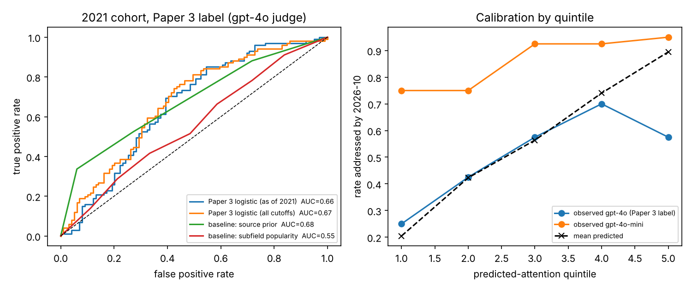
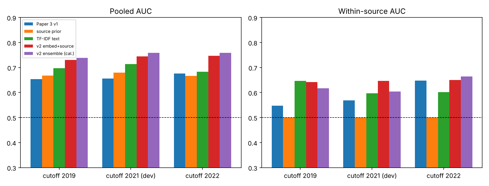
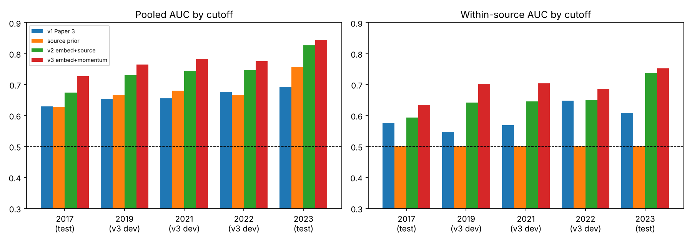

# scientific-discovery-astronomy

**Does the Paper 1–4 stack actually predict where astronomy goes next?**
This repository combines the four earlier papers into one astronomy forecaster
and tests it the only honest way available:

1. a pre-registered **out-of-time backtest** at a cutoff the stack has never
   seen (2021-12-31, outcomes 2022-01 → 2026-10);
2. a frozen **prospective forecast** made today (cutoff 2026-10-14), to be
   scored no earlier than 2031-10-15.

## 中文摘要

**结论：这套方法确实能预测哪些天文问题会被研究，而且经过三轮改进，第三版（v3）明显好于 Paper 3 原版。**

一共在 5 个历史年份（2017、2019、2021、2022、2023）各出约 200 题，约 1000 题。每轮都是先预注册、冻结预测并推送，之后才对答案。

| | v1（Paper 3 原版） | v2（语义+来源） | **v3（+话题热度）** |
|---|---|---|---|
| 整体 AUC（全新考场 2017+2023） | 0.65 | 0.74 | **0.77** |
| 同类问题内排序 | 0.59 | 0.67 | **0.69** |
| "证据矛盾"类问题内排序 | — | — | **0.69** |
| Brier（越低越好） | 0.253 | 0.206 | **0.191** |

- 原方法五个年份都稳定有效，AUC 在 0.63–0.69 之间。
- 关键新信号是"话题热度"：截止前相关论文越多、越在升温，问题之后越可能被研究。
- v3 在同类排序上显著好于 v1（+0.10）。比 v2 多出的 +0.03 没有达到显著。
- 判卷模型一换，结论就会大变：GPT-4o-mini 比 GPT-4o 宽松得多。
- Paper 4 的规划器没有预测力。

## The stack

| Paper | Repository | Role here |
| --- | --- | --- |
| 1 | [scientific-question-discovery](https://github.com/nonameisready/scientific-question-discovery) | evidence-tension question generation (via Paper 3's `evidence_tension` source) |
| 2 | [scientific-question-discovery-benchmark](https://github.com/nonameisready/scientific-question-discovery-benchmark) | freeze → temporal isolation → outcome labels; its 200-question 2026 instance is scored here too |
| 3 | [scientific-question-outcome-prediction-indicators](https://github.com/nonameisready/scientific-question-outcome-prediction-indicators) | the predictor: generators, six feature groups, models, outcome judge |
| 4 | [scientific-evidence-planner](https://github.com/nonameisready/scientific-evidence-planner) | ranked next-evidence actions; planner utility as a candidate predictor |

All upstream code and training data are vendored **unmodified** at pinned
commits under [`vendor/`](vendor/README.md).

The vendored predictor reproduces Paper 3's published temporal-split result
exactly: logistic AUC 0.7126.

## Order of events

The git history on GitHub timestamps each step.

| Commit | What | Labels exist? |
| --- | --- | --- |
| `bcf8469` | code + [pre-registration](docs/PREREGISTRATION.md) (H1–H7) | no questions yet |
| `60f0f5d` | 2021 cohort + all predictions frozen ([FREEZE.json](data/backtest2021/FREEZE.json)) | **no** |
| `2a896d8` | 2026 forecasts frozen | 2021 labels being computed, not yet seen |
| `5292d2c` | 2021 labels, evaluation, README | yes |
| `a4eea0f` | round-2 [pre-registration](docs/PREREGISTRATION_v2.md) + v2 models | no 2019/2022 questions yet |
| `bd84ebc`, `58fe4b7` | 2022 and 2019 cohorts + v1/v2 predictions frozen | **no** |
| `cc7892b` | 2019/2022 labels | yes |
| `18665c2` | round-3 [pre-registration](docs/PREREGISTRATION_v3.md) + v3 model + momentum features | no 2017/2023 questions yet |
| `d17b821` | 2017 and 2023 cohorts + v1/v2/v3 predictions frozen | **no** |
| `2f4f8cb` | 2017/2023 labels | yes |

## Data

- arXiv astro-ph, including cross-lists, 2013-01-01 → 2026-10-14: 236,290 papers.
- Harvested via OAI-PMH with v1 dates, classified by Paper 3's subfield rules.
- The harvest matches Paper 3's corpus per year and per subfield to within
  0.3% ([comparison](data/corpus/harvest_comparison.json)), so features are
  measured the way the model was trained.
- The raw corpus is not committed; rebuild it with `forecast.harvest_oai` and
  `forecast.corpus_build`.

## Study 1: out-of-time backtest (cutoff 2021-12-31)

### Setup

**Questions.** 200 questions from Paper 3's generators, unchanged: 8 subfields
× 25 = 10 evidence-tension, 5 direct-LLM, 5 author-future-work and 5 controls
per subfield. Past window 2014–2021.

**Primary model.** Paper 3's logistic model, trained **only on Paper 3's
2012/2014/2016 cutoffs**. Their labels end by 2021-12-31, so this is the model a
forecaster could actually have fit on the cutoff day. Paper 3's 2018 and 2020
labels run to 2023 and 2025, which overlaps this outcome window and would leak.

**Outcome.** "Substantively addressed" between 2022-01-01 and 2026-10-14,
using Paper 3's label: top-8 retrieved future papers plus the strict judge.

### Results

Paper 3 label (gpt-4o judge), n = 200, base rate 0.505.

| Hypothesis | Result | Verdict |
| --- | --- | --- |
| H1 discriminates out of time | AUC **0.656** [0.583, 0.733] | ✅ supported |
| H2a beats subfield popularity | ΔAUC +0.102 [+0.039, +0.167] | ✅ supported |
| H2b beats the generation-source prior | ΔAUC −0.024 [−0.109, +0.073]; source prior alone AUC 0.680 | ❌ not supported |
| H3 discriminates *within* source | mean 0.569 [0.496, 0.650] | ❌ not supported (details below) |
| H4 Brier below the constant | 0.2465 vs 0.2503 | ✅ by the rule, but negligible |
| H5 structure prior, tension questions | AUC 0.629 [0.505, 0.752] (n = 80) | ✅ barely |
| H6 Paper 4 utility does *not* predict attention | AUC 0.419 [0.305, 0.537] | ✅ null replicated (leans negative) |
| H7 Paper 4 top action matches the field's follow-up | pending (needs the citation crawl) | — |

**H3, per source.** Within-source AUC was 0.84 for controls, 0.64 for evidence
tension, 0.52 for future work, and 0.27 for direct LLM (inverted).

**Calibration by predicted quintile.**

| Quintile | Mean predicted | Observed rate |
| --- | --- | --- |
| 1 | 0.21 | 0.25 |
| 2 | 0.42 | 0.43 |
| 3 | 0.56 | 0.58 |
| 4 | 0.74 | 0.70 |
| 5 | 0.90 | **0.58** |

The bottom four quintiles are well calibrated. The top quintile is overconfident.

**Rates by source.** Direct-LLM questions were addressed 85% of the time,
future-work 48%, evidence-tension 45%, and controls 30%. This is the ordering
Paper 3 found, and most of what the model "knows".

**Not pre-registered, reported for completeness.**
- A plain TF-IDF text model trained on the same 2012–2016 data scored AUC 0.714
  [0.640, 0.781], at least as good as the structured model.
- Paper 3's GBM scored 0.654.
- Training on all five cutoffs (`m_logistic__all`, leaky for this window)
  scored 0.674.



Full numbers are in [`results/backtest2021/evaluation.json`](results/backtest2021/evaluation.json)
and per question in [`per_question.csv`](results/backtest2021/per_question.csv).

### What this says about the stack

1. **Paper 3's predictor transfers forward in time.** It is a little weaker
   than in its own era (0.66 vs 0.71), and it clearly beats field popularity.
2. **Most of its skill is knowing what kind of question it is looking at.**
   It does not beat a one-number-per-source prior. Broad LLM-written
   questions are almost always "engaged". Within those, the model's ranking
   is backwards.
3. **The question-level signal that does exist sits where Paper 1 placed it.**
   It is in ranking evidence-tension questions: model AUC 0.64, and the Paper 2/3
   structure prior 0.63. It also separates the weak controls well.
4. **Paper 4's planner is not a forecaster.** Its utility does not predict
   uptake, consistent with Paper 4's own retraction. Its top action is nearly
   constant: `run_simulation` for 77 of 78 questions under the default config,
   and `search_review` for all 78 under the Paper-3-informed config. So in its
   current form its recommendations carry little question-specific information.

## Round 2: two more cutoffs and a within-source model

[Pre-registered](docs/PREREGISTRATION_v2.md) after round 1. The v2 models
were designed on the 2021 cohort, which therefore serves as their
development set. Both test cohorts were generated, scored and frozen
before any of their labels existed:

- 2019: frozen at commit `58fe4b7`, outcome window 2020–2024, trained on
  cutoffs 2012 and 2014 only.
- 2022: frozen at commit `bd84ebc`, outcome window 2023 to 2026-10, trained
  on cutoffs 2012–2016.

**v2 models** ([`forecast/models_v2.py`](forecast/models_v2.py)):
- `v2_embed_src`: the question's embedding (`text-embedding-3-small`) plus a
  source fixed effect, so the rest of the model must explain variation
  *within* a source.
- `v2_ens_cal`: averages `v2_embed_src` with Paper 3's features (also with a
  source fixed effect), then applies Platt calibration on out-of-fold
  training predictions.

### Results on the fresh 2019 + 2022 cohorts

Paper 3 label (gpt-4o judge), n = 400, base rate 0.57.

| Hypothesis | Result | Verdict |
| --- | --- | --- |
| R1 v1 discriminates out of time | pooled AUC 0.659 [0.603, 0.709]; 2019: 0.654, 2022: 0.677 | ✅ replicated |
| R2 v2 ranks within a source | within-source AUC **0.646** [0.583, 0.710] | ✅ |
| R3 v2 beats v1 within a source | Δ +0.048 [−0.046, +0.142] | ❌ not significant |
| R4 v2 beats the source prior | pooled AUC **0.737** vs 0.669; Δ +0.068 [+0.019, +0.117] | ✅ |
| R5 calibrated v2 has the best Brier | v2 0.207 < source prior 0.224 < v1 0.240 < constant 0.248 | ✅ |
| R6 v2 ranks evidence-tension questions | AUC 0.606 [0.515, 0.694] | ✅ (barely) |

### All three cutoffs

This view is descriptive, because 2021 was the v2 development set.

| Model | 2019 pooled / within | 2021 (dev) pooled / within | 2022 pooled / within |
| --- | --- | --- | --- |
| v1 (Paper 3 logistic) | 0.654 / 0.548 | 0.656 / 0.569 | 0.677 / 0.648 |
| source prior | 0.667 / 0.500 | 0.680 / 0.500 | 0.667 / 0.500 |
| TF-IDF text | 0.697 / 0.647 | 0.714 / 0.597 | 0.683 / 0.602 |
| **v2 embed + source** | **0.730 / 0.642** | 0.745 / 0.646 | **0.747 / 0.650** |
| v2 ensemble, calibrated | 0.738 / 0.617 | 0.759 / 0.604 | 0.758 / 0.664 |



### What round 2 changes

- **Round 1's main result replicates.** Paper 3's model scores 0.65–0.68 at
  every new cutoff.
- **Round 1's H3 failure was partly noise in the 2021 cohort.** On the fresh
  cohorts v1's within-source AUC is 0.598 [0.531, 0.667]. Its inverted
  ranking of direct-LLM questions in 2021 (0.27) was 0.52 on the fresh
  cohorts.
- **v2 is the better forecaster.** It is the first model in this study to
  clearly beat the source-type prior. Its probabilities are also the
  best calibrated.
- **The within-source gain is real but modest.** v2 ranks questions inside a
  source at about 0.65, and inside tension questions at about 0.61. It is
  not yet significantly better than v1 *within* a source.
- **Under the lenient gpt-4o-mini label**, where 90% of questions count as
  addressed, the same picture holds more weakly: R1 0.651; R4 Δ +0.074
  [+0.009, +0.140].

Full numbers: [`results/round2/evaluation.json`](results/round2/evaluation.json).

## Round 3: topic momentum (fresh cutoffs 2017 and 2023)

The round-3 analysis was [pre-registered](docs/PREREGISTRATION_v3.md) and
committed as `18665c2`.

**What was added.**
- The corpus was extended to 2005–2026. It has 332k papers, and the per-year
  counts match Paper 3's harvest.
- Every subfield paper was embedded (`forecast/corpus_embed.py`).
- Each question gets **topic-momentum** features (`forecast/momentum.py`).
  They measure how many pre-cutoff papers sit close to the question, how
  recent those papers are, and whether that neighbourhood is growing.
- The v3 model averages v2's embedding model with a momentum + source model
  and is then Platt-calibrated (`forecast/models_v3.py`).

**How it was chosen.** v3 was chosen on development data only: the
2019/2021/2022 cohorts and Paper 3 leave-one-cutoff-out. On that data it
raised within-source AUC from 0.646 to 0.701 (`results/round3/dev_v3.json`).

**How it was tested.** It was then tested on two cohorts generated afterwards
(frozen at `d17b821`):
- 2017: trained on Paper 3's 2012 cutoff only.
- 2023: trained on cutoffs 2012–2018. Its outcome window is 2.79 years.

### Results on the fresh 2017 + 2023 cohorts

Paper 3 label (gpt-4o judge), n = 395, base rate 0.51.

| Hypothesis | Result | Verdict |
| --- | --- | --- |
| T1 v3 ranks within a source | within-source AUC **0.694** [0.612, 0.771] | ✅ |
| T2 v3 beats v2 within a source | Δ +0.028 [−0.008, +0.062] | ❌ not significant (just) |
| T3 v3 beats v1 within a source | Δ **+0.101** [+0.027, +0.176] | ✅ |
| T4 v3 beats the source prior | pooled AUC **0.769** vs 0.688; Δ +0.081 [+0.042, +0.123] | ✅ |
| T5 v3 probabilities beat v2's | Brier 0.191 vs 0.206 (v1 0.253) | ✅ |
| T6 v3 ranks evidence-tension questions | AUC **0.692** [0.604, 0.773] | ✅ |

Under the lenient gpt-4o-mini label, where 90% of questions count as
addressed, T2 *is* significant (Δ +0.094 [+0.038, +0.151]). We do not
substitute it, because it is not the pre-registered label.

### All five cutoffs

| Cutoff | v1 pooled / within | v2 pooled / within | v3 pooled / within |
| --- | --- | --- | --- |
| 2017 (test) | 0.630 / 0.577 | 0.674 / 0.594 | **0.728 / 0.634** |
| 2019 (v3 dev) | 0.654 / 0.548 | 0.730 / 0.642 | 0.765 / 0.703 |
| 2021 (v2+v3 dev) | 0.656 / 0.569 | 0.745 / 0.646 | 0.784 / 0.704 |
| 2022 (v3 dev) | 0.677 / 0.648 | 0.747 / 0.650 | 0.776 / 0.687 |
| 2023 (test) | 0.693 / 0.609 | 0.827 / 0.738 | **0.845 / 0.753** |

v3 is the best model at every cutoff, on both measures.



### Open threats before a paper

1. **No human audit of the labels.** Paper 2 found that human annotators agree
   with each other at only κ = 0.17.
2. **Momentum may partly predict the retriever.** The outcome label is found
   by text similarity to future papers, and dense topics are easier to match.
   A citation-graph label would break this link.
3. **The question generator (gpt-4o-mini) has seen post-cutoff literature.**
   This matters for every cutoff before late 2023.

Full numbers: [`results/round3/evaluation.json`](results/round3/evaluation.json).

## Study 2: the prospective forecast (cutoff 2026-10-14 → scored ≥ 2031-10-15)

Both tables are now ranked by the v2 model, frozen separately in
`FREEZE_v2.json`. The original v1 scores stay alongside, unchanged.

- **[`results/prospective2026/FORECAST.md`](results/prospective2026/FORECAST.md)**
  covers 200 new questions across the 8 subfields. It includes a ranking of the
  80 evidence-tension questions with Paper 4's next steps, which is the slice
  the backtest supports.
- **[`results/paper2_prospective2026/FORECAST.md`](results/paper2_prospective2026/FORECAST.md)**
  scores Paper 2's 200 questions frozen on 2026-08-17.
  - Mean `p_attention` by generator: direct LLM 0.48, tension-LLM 0.38,
    random claim 0.24, tension-template 0.02.
  - The template questions are ~80-word quoted statements, far outside the
    training distribution (flagged †). Their near-zero scores are an
    extrapolation artifact, not a forecast.

Every forecast table flags features outside the training 1st–99th percentile.
Pre-registered claims to check in 2031: **P1** AUC > 0.5, and **P2** the top
quintile is addressed more often than the bottom quintile.

## Deviations from the pre-registration

1. **Wrong judge named.**
   - What happened: the pre-registration called gpt-4o-mini "Paper 3's label,
     unchanged". That is the code's default, but Paper 3's committed labels
     were made with gpt-4o (956/980), and its paper calls mini the "lenient
     first-pass judge".
   - Check: re-judging 120 of Paper 3's own questions today on their own
     candidates, gpt-4o reproduces the published labels (agreement 0.92,
     κ = 0.83, identical 50.8% rate). gpt-4o-mini marks 93% as addressed
     (κ = 0.14). See [`results/judge_drift.json`](results/judge_drift.json).
   - Consequence: the analysis matching the pre-registered *intent* ("the label
     Paper 3's model was trained to predict") uses gpt-4o, which is the label
     shown above.
   - The as-written gpt-4o-mini label is also reported: base rate 0.86;
     H1 AUC 0.707 [0.590, 0.818]; H2b ΔAUC vs source +0.116 [−0.022, +0.253];
     H3 within-source 0.682 [0.567, 0.798].
   - Under that lenient label H3 would pass. We do not adopt it, because it is
     not the measurement the model was trained on.
2. **L3 citation source.** Semantic Scholar was used as pre-registered, but
   its anonymous API is heavily rate-limited, so the citation crawl runs
   slowly. L3 and H7 will be added when it completes.
3. **Outcome window** of 4.79 years instead of Paper 3's 5. This was stated in
   advance.

## Limitations

- **Hindsight in question generation.** Questions are written by gpt-4o-mini,
  whose training data postdates the 2021 cutoff, so some questions may encode
  hindsight; Paper 2 found this inflates direct-LLM engagement. The
  *predictor* is unaffected: it saw no post-2021 outcome.
- **The label is retrieval-bounded.** Paper 4 showed abstract retrieval misses
  engagement with narrow questions. The citation-graph label (L3) addresses
  this when the crawl finishes.
- **Sample size.** Three cohorts of 200 questions each, with one primary judge.
  The intervals are still about ±0.05 AUC.

## Reproduce

```bash
pip install -r requirements.txt            # OPENAI_API_KEY needed only for uncached LLM calls
python -m forecast.harvest_oai --from 2013-01-01 --until 2017-12-31 --tag w1   # (+ w2..w4, see corpus_manifest.json)
python -m forecast.corpus_build
python -m forecast.cohort backtest2021 && python -m forecast.predict backtest2021 && python -m forecast.freeze backtest2021
python -m forecast.label backtest2021 && python -m forecast.evaluate backtest2021
python -m forecast.judge_drift
python -m forecast.cohort prospective2026 && python -m forecast.predict prospective2026 && python -m forecast.forecast_table prospective2026
# round 2
python -m forecast.cohort backtest2019 && python -m forecast.predict backtest2019 && python -m forecast.predict_v2 backtest2019 && python -m forecast.freeze backtest2019
python -m forecast.label backtest2019 --no-citation    # same for backtest2022
python -m forecast.evaluate_v2
```

Every LLM response is cached under `data/cache/llm/` and committed, so all
results reproduce offline.
